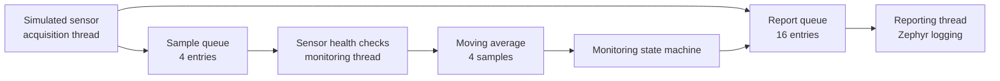

# Respiratory Monitor

A C++17 and Zephyr RTOS project that simulates respiratory sensor readings,
filters them, and detects faults on `qemu_cortex_m3`. No hardware is required.

**This is a simulation, not a medical device.** Its readings and
thresholds are synthetic and have no clinical meaning.

We explore periodic sampling, bounded memory, fault handling, and
thread communication in an embedded system.

## Architecture



Acquisition samples every **500 ms** using Zephyr uptime. Missed periods are
skipped. Each `SensorSample` carries simulated pressure (integer Pa), airflow
(signed integer mL/min), a monotonic timestamp in milliseconds, validity, and a
32-bit sequence number.

The monitoring thread validates each sample, filters it with a moving average,
and updates the state machine. Rejected samples and timeouts clear the filter.
The reporter receives snapshots and state changes through a separate queue.
The filter, simulator, and fault logic do not depend on Zephyr.

| Resource | Configuration | Behavior |
|---|---:|---|
| Acquisition thread | priority 2; 1024-byte stack | Owns simulator and acquisition counters. |
| Monitoring thread | priority 3; 2048-byte stack | Owns health checks, filter, state machine, and processing counters. |
| Reporting thread | priority 5; 2048-byte stack | Logs state changes, summaries, and observed stack use. |
| Sample queue | 4 samples | Nonblocking enqueue; a full queue drops the **newest** sample and increments `dropped`. |
| Report queue | 16 records | Nonblocking, best-effort reporting; lost reports are counted. |
| Moving-average buffer | 4 samples | Fixed capacity; a new sample overwrites the oldest when full. |

Lower numerical priorities run first. Queue records are copied by value. The
application uses fixed storage and makes no intentional heap allocations; the
Zephyr heap pool is set to zero. Logging runs synchronously in the reporter.
If the report queue fills, log events can be lost; `COUNTERS` reports those losses.

## States and fault handling

`MonitorConfig` defines simulated upper thresholds of 180 Pa / 70 mL/min for
WARNING and 350 Pa / 140 mL/min for FAULT. Comparisons are inclusive. The default
configuration requires three consecutive abnormal events for WARNING or FAULT,
and four consecutive accepted, normal filtered samples for initialization or
recovery. Fault-level events also count as abnormal; FAULT takes precedence if
both thresholds are reached together.

| Current state | Condition | Next state |
|---|---|---|
| INITIALISING | 4 consecutive normal samples | MONITORING |
| INITIALISING or MONITORING | 3 consecutive abnormal events | WARNING |
| Any | 3 consecutive fault-level events | FAULT |
| WARNING or FAULT | 4 consecutive normal samples | MONITORING, fault cleared |
| FAULT | Warning-level input or incomplete recovery | FAULT, previous fault retained |
| Any | Invalid configuration | FAULT immediately |

Normal input resets abnormal streaks; warning-only input resets the fault streak.
Any abnormal event interrupts recovery. Different fault-level causes can form one
streak; once confirmed, the latest cause becomes the active reason.

`SensorHealth` checks raw samples against `SensorHealthConfig` before filtering.
Defaults are an inclusive synthetic envelope of 0–500 Pa and 0–200 mL/min, a maximum age of 1000 ms, and a
limit of three consecutive identical pressure/airflow pairs. The fourth matching
pair is rejected as frozen. Faults are selected in this order when they coincide:
invalid configuration, stale timestamp, sequence order/gap, invalid source flag,
out-of-range values, then frozen values. Filtered pressure takes precedence over
filtered airflow when both exceed fault thresholds. A missing sample is a separate
timeout event.

A receive waits 750 ms after the last delivered sample, then generates additional
timeout events at 500 ms intervals while samples remain absent. A detected forward
sequence gap counts missing sequence numbers and rejects the next sample; the
following fresh, consecutive sample can begin recovery. Sequence arithmetic is
modulo 2^32: forward distances below 2^31 are distinguishable from duplicates,
backward, or ambiguous distances. This assumes fewer than 2^31 consecutive missing
sequence numbers and an initial sequence of zero. Reconstruct the health checker
when resetting or replacing a sensor source.

Timestamp checks use signed 64-bit Zephyr uptime and check sign/order before
subtraction. The deadline calculations assume uptime does not approach the
approximately 292-million-year signed-millisecond limit. Event counters are
unsigned 64-bit and wrap modulo 2^64; debounce counters saturate. Acquisition and
monitoring snapshots are independent, so a summary is not an atomic cross-thread
accounting snapshot.

## Deterministic scenarios

Each scenario lasts eight acquisition attempts. A full cycle takes 40 seconds
of simulated time; QEMU may advance faster than wall time.

| Attempts | Scenario | Synthetic input |
|---|---|---|
| 0–7 | normal | Pressure 100–107 Pa, airflow 40–44 mL/min |
| 8–15 | elevated | Pressure 200–207 Pa, airflow 80–84 mL/min |
| 16–23 | critical | Pressure 400–407 Pa, airflow 160–164 mL/min |
| 24–31 | invalid | Normal ramp with `valid=false` |
| 32–39 | out of range | −1000 Pa / 1,000,000 mL/min, marked valid to exercise range validation |
| 40–47 | stale timestamp | Normal ramp with a timestamp 2000 ms behind uptime |
| 48–55 | sequence gap | Normal ramp with one skipped sequence before each sample |
| 56–63 | frozen | Constant 100 Pa / 40 mL/min with advancing timestamps and sequence numbers |
| 64–71 | timeout | No sample is delivered |
| 72–79 | recovery | Normal ramp; first delivery reveals the missing sequence gap |

Sequence numbers advance on missing attempts and injected skips. In the first
cycle, the last sample before timeout has sequence 71 and the first recovery
sample has sequence 80. The simulator repeats until QEMU is stopped.

## Repository layout

```text
.github/workflows/zephyr-ci.yml    GitHub Actions build and QEMU checks
ci/requirements.txt                Pinned CI Python dependencies
include/respmon/                   Domain types, configuration, and interfaces
src/                               Domain logic and Zephyr thread orchestration
tests/                             Host tests and bounded QEMU integration runner
tests/ztest/                       Standalone Zephyr ztest application
CMakeLists.txt, prj.conf           Application build and Zephyr configuration
```

Git-tracked files do not contain a Zephyr checkout or SDK. Build directories,
logs, local environments, and caches are ignored.

## macOS prerequisites and setup

The verified environment is Apple silicon macOS with Python 3.12.16, west 1.5.0,
CMake 4.4.4, Zephyr commit `ec98918869caeb2ddaef6e698f9ff36fb60a97ac`
(`v4.5.0-rc3-40-gec98918869ca`), and Zephyr SDK 1.0.1 with the ARM toolchain and
QEMU host tools. The commands below assume this application is already checked out
at `~/zephyrproject/respiratory-monitor`; no public GitHub URL has been configured
for this repository.

For a **new** workspace only, with no existing `~/zephyrproject/zephyr`,
`~/zephyrproject/.west`, or `~/zephyr-sdk-1.0.1`, the following provisions the
pinned environment. Do not run the clone/checkout steps against an existing
Zephyr checkout. Fresh-machine provisioning was not re-executed during the release
audit; the existing environment and clean builds were verified instead.

```sh
brew install cmake ninja gperf dtc python@3.12
cd ~/zephyrproject/respiratory-monitor
python3.12 -m venv ../.venv312
source ../.venv312/bin/activate
python -m pip install -r ci/requirements.txt

git clone --filter=blob:none --no-checkout https://github.com/zephyrproject-rtos/zephyr.git ../zephyr &&
git -C ../zephyr checkout --detach ec98918869caeb2ddaef6e698f9ff36fb60a97ac &&
west init -l ../zephyr &&
west update cmsis_6

mkdir -p .cache/sdk-downloads
sdk_url=https://github.com/zephyrproject-rtos/sdk-ng/releases/download/v1.0.1
sdk_archive=zephyr-sdk-1.0.1_macos-aarch64_minimal.tar.xz
arm_archive=toolchain_gnu_macos-aarch64_arm-zephyr-eabi.tar.xz
curl --fail --location --retry 3 -o ".cache/sdk-downloads/$sdk_archive" "$sdk_url/$sdk_archive" &&
curl --fail --location --retry 3 -o ".cache/sdk-downloads/$arm_archive" "$sdk_url/$arm_archive" &&
printf '%s  %s\n' 867063901f39528a6175a80ebc20367bd6cb440593e7e2650eda30392f1f6a7eb ".cache/sdk-downloads/$sdk_archive" | shasum -a 256 -c - &&
printf '%s  %s\n' 4008edb5d4840cd994aedd7f1309bfb63e7243729d57839ebf1cc83c1f17c886 ".cache/sdk-downloads/$arm_archive" | shasum -a 256 -c - &&
tar -xf ".cache/sdk-downloads/$sdk_archive" -C "$HOME" &&
mkdir -p "$HOME/zephyr-sdk-1.0.1/gnu" &&
tar -xf ".cache/sdk-downloads/$arm_archive" -C "$HOME/zephyr-sdk-1.0.1/gnu"
```

For the existing workspace used by this project, activate and select the SDK
without modifying the Zephyr checkout:

```sh
cd ~/zephyrproject/respiratory-monitor
source ~/zephyrproject/.venv312/bin/activate
export ZEPHYR_SDK_INSTALL_DIR="$HOME/zephyr-sdk-1.0.1"
export ZEPHYR_TOOLCHAIN_VARIANT=zephyr
export CCACHE_DIR="$PWD/.cache/ccache"
export PYTHONDONTWRITEBYTECODE=1
```

## Build and run

From the activated environment above, build the application from a pristine
`build/` directory and start the interactive QEMU runner:

```sh
west build -p always -b qemu_cortex_m3 .
west build -d build -t run
```

To exit QEMU, press **Ctrl-A**, then **X**. Alternatively, run one complete
scenario and validate its output automatically:

```sh
python tests/run_qemu_ci.py --build-dir build --log build-release-normal.log --mode normal
```

These lines are from a normal QEMU run. Timestamps are simulated uptime.

```text
[00:00:01.500,000] <inf> respmon: STATE time=1500 ms from=INITIALISING to=MONITORING reason=none changed=1
[00:00:06.000,000] <wrn> respmon: STATE time=6000 ms from=MONITORING to=WARNING reason=none changed=1
[00:00:10.000,000] <err> respmon: STATE time=10000 ms from=WARNING to=FAULT reason=pressure_threshold changed=1
[00:00:29.500,000] <wrn> respmon: HEALTH time=29500 ms reason=frozen_sensor gaps=8
[00:00:38.000,000] <inf> respmon: STATE time=38000 ms from=FAULT to=MONITORING reason=none changed=1
[00:00:40.000,000] <inf> respmon: COUNTERS time=40000 ms attempts=81 enqueued=73 dropped=0 missing=8 total=72 valid=34 invalid=38 timeouts=8 gaps=16 report_drops=0/0
```

Every two seconds, `SUMMARY` logs the state, scenario, fault reason, latest raw
and filtered readings, validity, and sample counts. Every ten seconds, `COUNTERS`
and `STACK` log detailed counters and observed stack watermarks. If the latest
event is a timeout, `latest_event_sample=0` and `filtered_valid=0`; displayed
sample values are retained history.

## Build and test

Run these commands from the repository root with the environment activated.

```sh
# RTOS-independent host tests
cmake -S tests -B build-release-host
cmake --build build-release-host
ctest --test-dir build-release-host --output-on-failure

# Zephyr ztest suite on QEMU
west build -p always -b qemu_cortex_m3 -d build-release-ztest tests/ztest
python tests/run_qemu_ci.py --build-dir build-release-ztest --log build-release-unit.log --mode unit

# Forced queue-overflow integration scenario
west build -p always -b qemu_cortex_m3 -d build-release-stress . -- -DRESPMON_PIPELINE_STRESS_TEST=ON
python tests/run_qemu_ci.py --build-dir build-release-stress --log build-release-stress-run.log --mode stress
```

The host tests cover domain behavior; the 15 ztests run it on Zephyr. The QEMU
runner checks a full scenario and exits automatically. The overflow build delays
monitoring at startup to check drop accounting and recovery.
`tests/ztest/tests.yaml` also supports Twister.

The GitHub Actions workflow builds the pinned Zephyr revision and SDK, runs the
ztests, and runs both QEMU integration scenarios. Python build dependencies and
Actions are version-pinned; the Ubuntu runner and Python patch version may change.
No dependency cache is configured. This checkout has no GitHub remote configured,
so no status badge is included and the workflow has not been verified on GitHub.

## Observed resources

A pristine normal build on the verified environment during the release audit
reported **29,064 bytes FLASH / 262,144 bytes** and **12,936 bytes RAM / 65,536
bytes** in the linker memory-region summary. Zephyr's symbol reports showed
29,052 bytes ROM and 12,933 bytes RAM; these totals differ slightly from the
linker region totals. These are observations for this build, not runtime peaks.

```sh
west build -d build -t rom_report
west build -d build -t ram_report
```

With `CONFIG_INIT_STACKS` and `CONFIG_THREAD_STACK_INFO` enabled,
`k_thread_stack_space_get()` reported the following high-water usage at 40 seconds
of simulated time in the normal run:

| Thread | Observed high water | Configured stack |
|---|---:|---:|
| Acquisition | 476 bytes | 1024 bytes |
| Monitoring | 852 bytes | 2048 bytes |
| Reporting | 1100 bytes | 2048 bytes |

These are observations from one QEMU run, not worst-case bounds. Stack sentinels
and assertions are enabled. An unsupported stack inspection produces a warning.

## Limitations and future work

- This is a simulation: there are no physical sensors, calibration, treatment
  decisions, clinical claims, certification, or deployment guarantees.
- Only synthetic upper excursions are classified. Timeout and threshold settings
  are fixed at construction; sequence freshness assumes the documented half-range.
- Frozen-value detection requires repeated readings. A prior partial recovery
  streak can complete before a new identical run reaches the frozen limit.
- QEMU and a short test run do not establish real-hardware timing, worst-case stack
  usage, long-duration reliability, or absence of races in other configurations.
- Queue drops and report drops are counted, but lost samples and log transitions
  cannot be reconstructed. No persistent event storage is provided.
- The CI workflow has not yet run on GitHub; fresh macOS provisioning and other
  hardware/host platforms have not been validated in this audit.

Useful next steps include configuration validation across custom sensor and
monitor settings, additional on-target stress/stack analysis, configurable
scenario selection, tests for sustained reporting overload, and a hardware
adapter with its own validation and integration tests.
